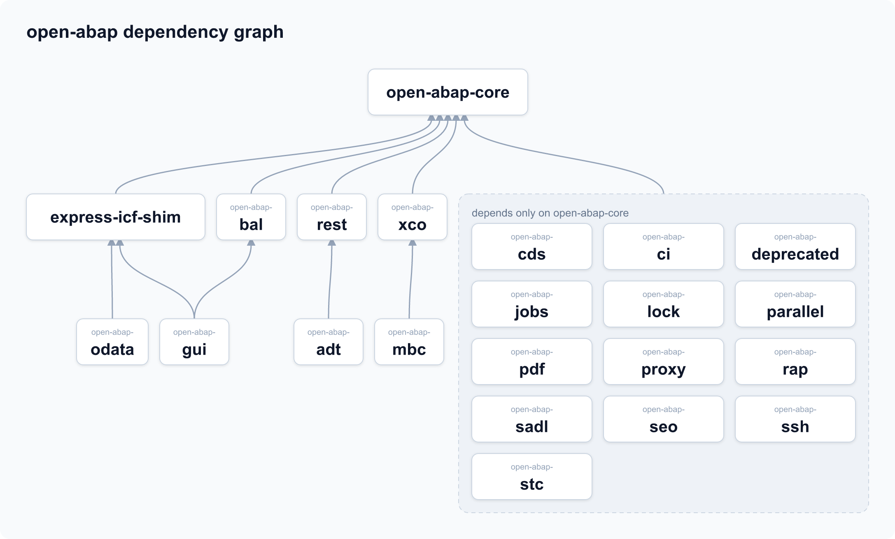

Fast sustainable Continuous Integration enabling Preview Deployments

### Basics
* [open-abap-core](https://github.com/open-abap/open-abap-core) Basics
* [open-abap-deprecated](https://github.com/open-abap/open-abap-deprecated) 👷

### Extras
* [open-abap-adt](https://github.com/open-abap/open-abap-adt) ADT REST scaffolding
* [open-abap-bal](https://github.com/open-abap/open-abap-bal) Business Application Logging
* [open-abap-brf](https://github.com/open-abap/open-abap-brf) 😅 BRF+
* [open-abap-cds](https://github.com/open-abap/open-abap-cds) CDS
* [open-abap-ci](https://github.com/open-abap/open-abap-ci) Code Inspector / ATC
* [open-abap-gui](https://github.com/open-abap/open-abap-gui) GUI scaffolding
* [open-abap-jobs](https://github.com/open-abap/open-abap-jobs) Background jobs
* [open-abap-lock](https://github.com/open-abap/open-abap-lock) Concurrent locking/enqueue
* [open-abap-mbc](https://github.com/open-abap/open-abap-mbc) Business Configuration
* [open-abap-odata](https://github.com/open-abap/open-abap-odata) OData / Gateway
* [open-abap-parallel](https://github.com/open-abap/open-abap-parallel) Parallel processing
* [open-abap-proxy](https://github.com/open-abap/open-abap-proxy) Proxy
* [open-abap-rap](https://github.com/open-abap/open-abap-rap) RESTful Application Programming Model
* [open-abap-rest](https://github.com/open-abap/open-abap-rest) REST classes
* [open-abap-sadl](https://github.com/open-abap/open-abap-sadl) SADL
* [open-abap-seo](https://github.com/open-abap/open-abap-seo) ABAP OO Dev Tools
* [open-abap-stc](https://github.com/open-abap/open-abap-stc) Technical Configurations
* [open-abap-xco](https://github.com/open-abap/open-abap-xco) XCO

### Misc

* [express-icf-shim](https://github.com/open-abap/express-icf-shim)
* [open-abap-ssh](https://github.com/open-abap/open-abap-ssh) 😅 Secure Shell (SSH)
* [open-abap-pdf](https://github.com/open-abap/open-abap-pdf) 😅 PDF Generation and Manipulation

### Dependencies

